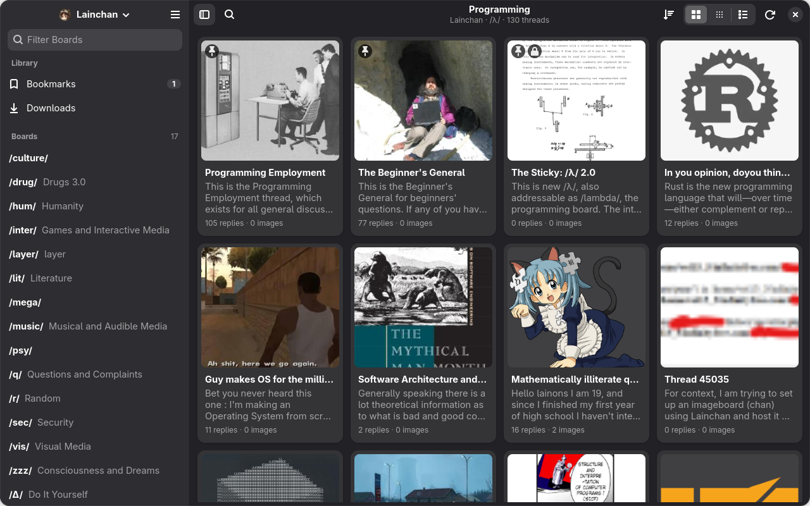
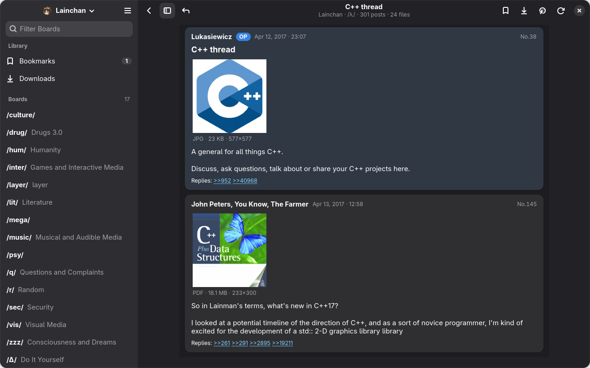
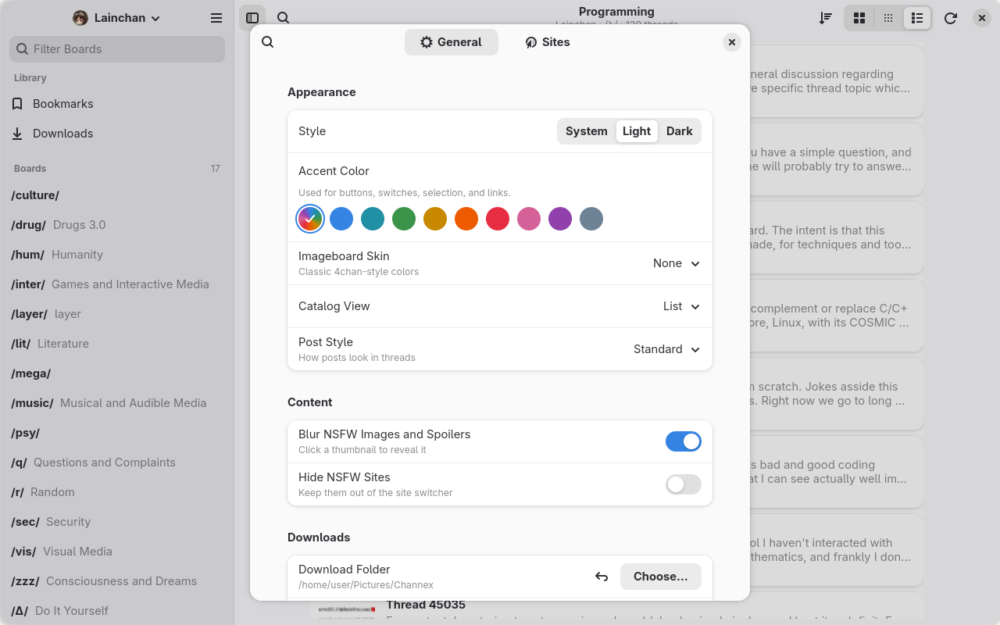
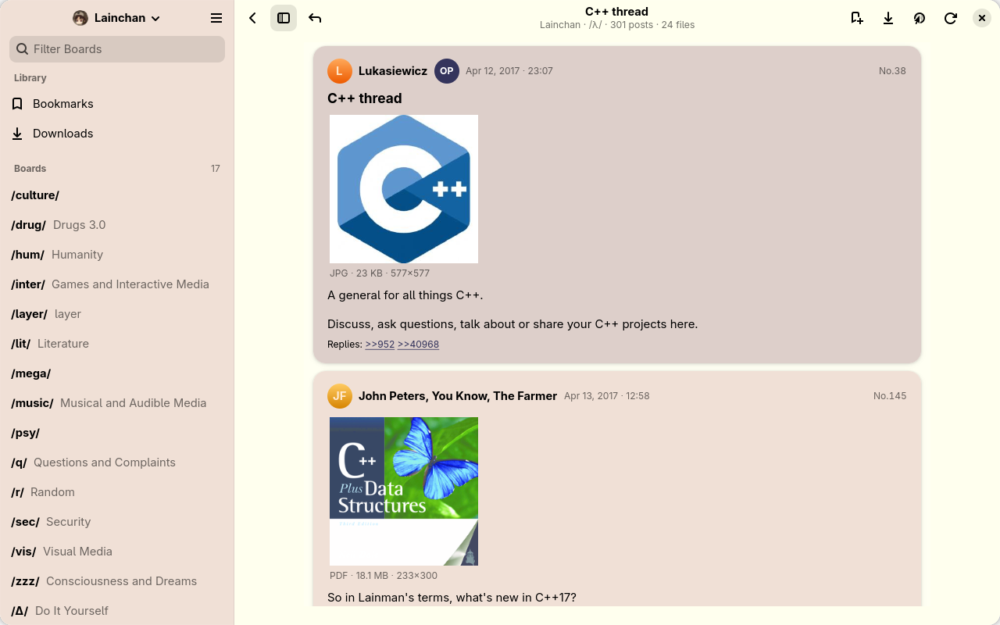

# Channex

A native desktop app for browsing chan-style imageboards: 4chan, 8kun,
Lainchan, and any other site with a 4chan-compatible API (vichan) or
running LynxChan. Built with **GTK 4 and libadwaita in Rust**, so it looks
and behaves like a GNOME app.

Linux is the main platform. Windows support is planned (see
[ROADMAP.md](ROADMAP.md)).

| Catalog | Thread |
|---|---|
|  |  |

| Preferences | Classic skins |
|---|---|
|  |  |

## Features

- **Sites and boards:** 4chan, 8kun and Lainchan built in, plus any
  custom 4chan-style or LynxChan site. Each site's board list is fetched
  live (with a built-in fallback), can be filtered, and boards can be
  hidden from the sidebar.
- **Catalog:** grid, compact grid or list; search (or paste a thread link
  to jump to it); sort by latest bump, replies, images or age, with
  stickies first. NSFW and spoiler thumbnails are blurred until clicked.
- **Threads:** quote links scroll to the quoted post, hovering one shows a
  preview, and every post lists its replies. Three post styles. Right-click
  a post to reply, copy it, download its files, or (on 4chan) report it.
- **Media viewer:** images, GIFs and videos full-window, with swipe or
  arrow keys between files, click or pinch to zoom, looping GIFs, and a
  filmstrip of every file in the thread. When a site holds a video up
  (for example by rate limiting), the viewer says why.
- **Bookmarks** that count new replies since you last looked.
- **Downloads:** pick which of a thread's files to save; four download at
  a time, into a folder per thread (named by number or subject), with
  progress, retries, and a toast when done.
- **Replying:** in the app on LynxChan sites (with their captcha). On
  4chan, Lainchan and 8kun, write your reply in Channex and continue on
  the site, whose captcha only works there.
- **Appearance:** follows the system's light/dark style and accent color,
  or set your own; five classic imageboard skins (Yotsuba, Yotsuba B,
  Futaba, Photon, Burichan). Party hats on post images every October 1st,
  4chan's birthday (can be turned off).
- **Storage:** the image cache can be cleared by hand, on a schedule, or
  kept under a size limit. Videos stream and are never stored.
- **Keyboard:** Ctrl+F search, F5 refresh, Ctrl+D bookmark, F9 sidebar,
  Alt+Left back, Ctrl+, preferences, Ctrl+? for the full list.
- A welcome tour on first launch. Settings and bookmarks from the earlier
  Qt version of Channex are imported automatically.

### Not yet

- **Windows** builds are the last item on the roadmap.
- **8chan.moe** isn't supported: its API now blocks apps that aren't
  web browsers.

## Installing

Each [GitHub release](https://github.com/niruxx/Channex/releases) has
packages for Arch, Debian/Ubuntu, Fedora, an AppImage and a Flatpak
bundle. Channex needs GTK 4.18+ and libadwaita 1.8+: Arch, Fedora 43+,
Ubuntu 25.10+, Debian testing/unstable (not Debian 13), or any distro via
the Flatpak.

| Distro | Install |
|---|---|
| Arch | `sudo pacman -U channex-0.2.0-1-x86_64.pkg.tar.zst` |
| Debian / Ubuntu | `sudo apt install ./channex_0.2.0-1_amd64.deb` |
| Fedora | `sudo dnf install ./channex-0.2.0-1.fc43.x86_64.rpm` |
| AppImage | `chmod +x Channex-0.2.0-x86_64.AppImage && ./Channex-0.2.0-x86_64.AppImage` |

For video playback, install your distro's GStreamer "good" and libav
plugins.

### Building the packages yourself

| Package | Command | Needs |
|---|---|---|
| Arch | `cd packaging/arch && makepkg -si` | base-devel |
| Debian | `packaging/debian/build-deb.sh` | only `ar` and `tar` |
| Fedora | `packaging/fedora/build-rpm.sh` | rpm-build, on Fedora 43+ |
| AppImage | `packaging/appimage/build-appimage.sh` | downloads linuxdeploy |

All write to `dist/` (Arch to `packaging/arch/`).

## Building

Requires Rust (stable), GTK 4.18+, libadwaita 1.8+, blueprint-compiler,
and CMake (for the TLS library). Video playback needs GStreamer's good
plugins and libav (`gst-plugins-good gst-libav` on Arch).

```sh
# Arch
sudo pacman -S rust gtk4 libadwaita blueprint-compiler cmake
# Fedora
sudo dnf install rust cargo gtk4-devel libadwaita-devel blueprint-compiler cmake

cargo run
```

On Debian or Ubuntu, use a release that ships libadwaita 1.8 or newer
(`libgtk-4-dev libadwaita-1-dev blueprint-compiler cmake`).

### Flatpak

```sh
# Needs flatpak-builder, the GNOME 50 SDK and the Rust SDK extension.
pip install aiohttp tomlkit
curl -LO https://raw.githubusercontent.com/flatpak/flatpak-builder-tools/master/cargo/flatpak-cargo-generator.py
python3 flatpak-cargo-generator.py Cargo.lock -o packaging/flatpak/cargo-sources.json
flatpak-builder --user --install --force-clean packaging/flatpak/build-dir \
  packaging/flatpak/io.github.niruxx.Channex.json
```

### Releases

Pushing a `v*` tag runs `.github/workflows/release.yml`, which builds the
Arch package and the Flatpak bundle and attaches them to the release.

## Development

```sh
cargo test                                  # offline tests (fixtures in tests/fixtures/)
cargo test --test live -- --ignored         # adapters against the real sites
cargo clippy --all-targets -- -D warnings
```

### Checking the UI headlessly

Debug builds can render the window to a PNG and exit, which works inside
a throwaway headless GNOME compositor:

```sh
cargo build
dbus-run-session -- sh -c '
  mutter --headless --wayland --no-x11 --virtual-monitor 1440x900 \
         --wayland-display channex-test & sleep 2
  WAYLAND_DISPLAY=channex-test CHANNEX_SCREENSHOT=$PWD/shot.png ./target/debug/channex'
```

`CHANNEX_SCREENSHOT_DELAY_MS` sets the wait (default 3000).
`CHANNEX_DEV_PAGE` opens something first: `bookmarks`, `preferences`,
`preferences:sites`, `preferences:storage`, `add-site`, or `<what>:<site>:<board>:<thread>` where
`<what>` is `thread`, `reply`, `download-dialog`, or `download-test`
(downloads the thread's first six files), or
`media:<site>:<board>:<thread>:<file index>[:zoom]`, or
`media-stress:<site>:<board>:<thread>:<file index>` (switches and closes
videos mid-stream). `CHANNEX_DEV_WATCHDOG=1` logs any UI freeze over
250 ms. `CHANNEX_DEV_FAKE_429=1` makes video streams act as if the site
were rate-limiting them.
`CHANNEX_DEV_BIRTHDAY=1` shows the October 1st birthday hats today. Point `XDG_DATA_HOME` at a
scratch folder to use test settings.

## Architecture

The crate has two halves. The **library** (`src/lib.rs`, `src/data/`) is
the imageboard core with no GTK dependency, so it can be tested on its
own. The **binary** is the GTK app on top of it.

| `src/data/` | What |
|---|---|
| `model.rs` | Sites, boards, posts, files, threads |
| `adapters/` | Yotsuba (4chan, vichan, 8kun) and LynxChan API parsing |
| `comment.rs` | Board HTML → a small inline tree → Pango markup |
| `http.rs` | The shared HTTP client and its request policy |
| `sites.rs` | Preset and custom sites, thread-link resolution |
| `catalog.rs` | Catalog search and sort |
| `store.rs` | Settings and bookmarks file (imports the Qt version's data) |
| `downloads.rs` | Safe, unique file and folder names |
| `cache.rs` | When to clear the image cache, and what to evict |
| `posting.rs` | LynxChan captcha and reply API |

| App | What |
|---|---|
| `src/application.rs` | `AdwApplication`: app actions, About, shortcuts |
| `src/window/` | Main window: sidebar, site switcher, navigation |
| `src/pages/` | Catalog, thread, bookmarks and downloads pages |
| `src/widgets/` | Catalog cards and rows, thread posts |
| `src/dialogs/` | Preferences, Add Site, Reply, Download Files, Welcome tour |
| `src/state.rs` | App-wide state (store, HTTP client, board lists) with change signals |
| `src/downloads.rs` | Download manager |
| `src/theme.rs` | Light/dark, accent color, classic skins |
| `src/birthday.rs` | Birthday hats on October 1st |
| `src/viewer/` | Media viewer: carousel, zoomable images, video streamed over HTTP ranges |
| `src/thumbnails.rs` | Image loading with memory and disk caches |
| `src/cache.rs` | Image cache clearing: on demand, scheduled, size limit |
| `src/runtime.rs` | Background runtime for network work |
| `src/devtools.rs` | Debug-only helpers (headless screenshots) |
| `data/` | Blueprint UI files, stylesheet, icon, desktop entry, metainfo |
| `packaging/` | Arch, Debian, Fedora, AppImage and Flatpak packaging |

## History

Channex started as a Tauri + React app, was rebuilt in Qt 6 / QML, and
was then rewritten as this GTK app (version 0.2.0). The last Qt version
is commit `7cef950`.

## AI usage disclaimer

Parts of this project (code, documentation, and/or assets) were written or assisted by AI tools. Review changes accordingly.
